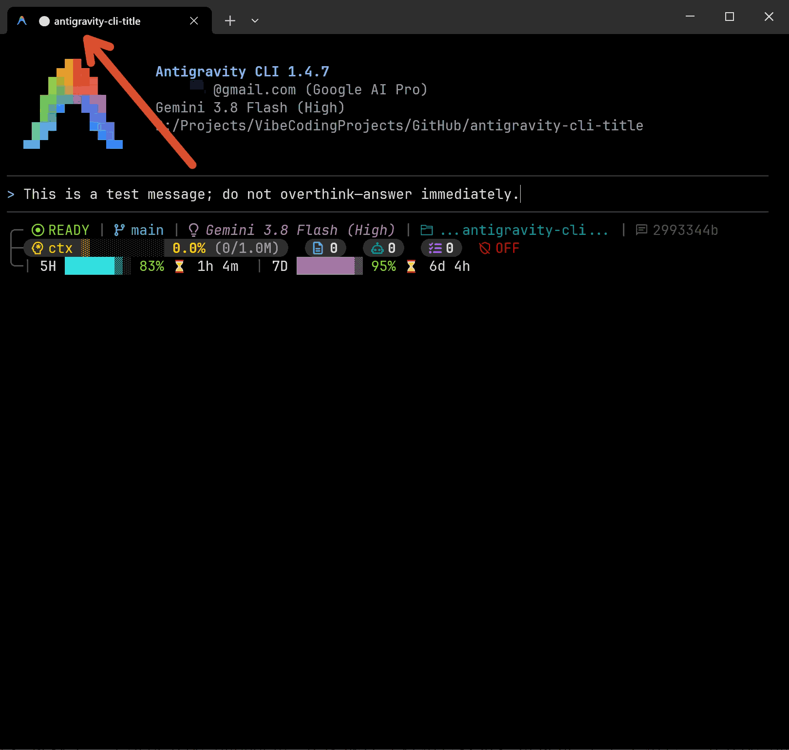
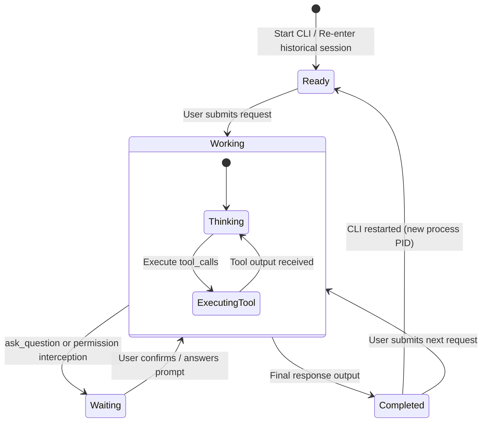

# Antigravity CLI Window Title (`antigravity-cli-title`)

<p align="center">
  <b>Dynamic, State-Aware Window Title Indicator for Google Antigravity CLI (<code>agy</code>)</b>
</p>

<p align="center">
  <a href="LICENSE"></a>
  <a href="https://github.com/google-antigravity/antigravity-cli"></a>
  
</p>

<p align="center">
  <b>English</b> | <a href="README.zh-CN.md">简体中文</a>
</p>

<p align="center">
  
</p>

---

## 💡 Why `antigravity-cli-title`?

When working across multiple terminal tabs or windows in parallel, switching between tasks makes it difficult to track which session is still running, which one finished, and which one is blocked waiting for your input.

Existing solutions (like bottom statuslines) only work when the window is in the foreground. Default title scripts treat waiting for user approval as ordinary tool execution, causing background sessions to appear busy when they are actually halted.

**`antigravity-cli-title`** implements a **4-state lifecycle state machine** directly in your terminal tab / window title:

```
[Window Tab]  agy: ⚪ Docker compose setup            <- Idle / waiting for first instruction
[Window Tab]  agy: ⚙️ Fix user login issue            <- Currently thinking / executing
[Window Tab]  agy: ⚠️ Deploy to production            <- Blocked! Waiting for your confirmation
[Window Tab]  agy: ✅ Refactor database schema        <- Finished! Ready for review
```

---

## ✨ Key Features

- **🎯 Complete 4-State Machine**:
  - `⚪ Ready`: Clean initial state after launching or reopening a historical conversation.
  - `⚙️ Working`: Actively thinking, reading files, executing commands, background tasks (Tasks), or subagents (Subagents).
  - `⚠️ Waiting`: Interactively waiting for user input (`ask_question`) or permission approvals (`permissions.ask`, returns to Working once authorized).
  - `✅ Completed`: Remains marked as done after outputting the final response and all background tasks/subagents finish.
- **⚡ Background & Interruption Awareness**:
  - Deep-parses `transcript.jsonl` tails and `settings.json` permission rules, linking active tasks/subagents and native process trees to accurately distinguish running jobs from authorization prompts.
- **🪟 Multi-Window Isolation**:
  - Binds conversation IDs with active CLI process lifecycles. Zero cross-window state pollution.
- **🏷️ Intelligent Title Hierarchy**:
  - `conversation_title` ➔ First user request (smartly truncated) ➔ Current workspace directory name.
- **🚀 Ultra-Fast Native Execution Engine (`title.exe`)**:
  - Pure Go native renderer with zero external dependencies, directly invoking Windows system APIs (`NtQueryInformationProcess`, `winsqlite3.dll`) with sub-3ms latency.
  - Automatically installed, compiled, or downloaded via `install.ps1`.
- **🌐 Cross-Platform Native Support**:
  - Universal **Go native binary (`title.exe` / `title`)** for Windows, Linux, and macOS.
  - Sub-3ms latency with zero Python or PowerShell dependencies.

---

## 📊 State Reference Table

| Status Indicator | Text Mode | Agent Phase | What It Means |
| :---: | :---: | :--- | :--- |
| **`⚪`** | `[READY]` | **Initial / Idle** | Fresh session opened or historical session restored; waiting for user prompt. |
| **`⚙️`** | `[WORKING]` | **Thinking / Tool Use** | Agent is thinking, analyzing code, running tests, or executing commands. |
| **`⚠️`** | `[WAITING]` | **User Interaction Blocked** | Agent called `ask_question` or triggered a sensitive permission prompt requiring user confirmation. |
| **`✅`** | `[DONE]` | **Completed** | Agent completed all work for this turn and finished responding. Stays done until next input. |

---

## 🚀 Quick Start

### Windows (PowerShell)

Run the following command in PowerShell:

```powershell
# One-line installation via GitHub
irm https://raw.githubusercontent.com/kjqg-cn/antigravity-cli-title/main/install.ps1 | iex
```

*Or install locally from source:*

```powershell
git clone https://github.com/kjqg-cn/antigravity-cli-title.git
cd antigravity-cli-title
.\install.ps1
```

### Linux / macOS (Bash)

Run the following command in your terminal:

```bash
# One-line installation via GitHub
curl -fsSL https://raw.githubusercontent.com/kjqg-cn/antigravity-cli-title/main/install.sh | bash
```

*Or install locally from source:*

```bash
git clone https://github.com/kjqg-cn/antigravity-cli-title.git
cd antigravity-cli-title
./install.sh
```

---

## ⚙️ Configuration & Options

The installation automatically updates `~/.gemini/antigravity-cli/settings.json`:

```json
{
  "title": {
    "type": "command",
    "command": "C:/Users/YourName/.gemini/antigravity-cli-title/title.exe",
    "enabled": true
  }
}
```

### Custom CLI Flags

You can customize the command behavior by appending flags in `settings.json`:

| Flag | Example | Description |
| :--- | :--- | :--- |
| `--no-prefix` | `title.exe --no-prefix` | Hides the leading `agy: ` tag (output: `✅ Refactor login`). |
| `--prefix <str>` | `title.exe --prefix "🤖"` | Customizes the prefix tag. |
| `--text` / `--classic` | `title.exe --text` | Uses ASCII text indicators like `[DONE]` instead of emojis. |
| `--max-length <n>` | `title.exe --max-length 40` | Sets max character length for truncated titles (default: 35). |
| `--task-timeout <n>` | `title.exe --task-timeout 60` | Background task silence threshold in seconds before auto-releasing to DONE (default: 60). |

---

## 🏗️ State Machine Architecture



---

## 🗑️ Uninstallation

To remove the title configuration and restore your previous settings:

### Windows:
```powershell
# Run the uninstaller directly from the installation directory:
powershell.exe -File "$HOME\.gemini\antigravity-cli-title\uninstall.ps1"

# To completely purge the installation directory and all markers:
powershell.exe -File "$HOME\.gemini\antigravity-cli-title\uninstall.ps1" -Purge
```
*(Or run `.\uninstall.ps1 [-Purge]` from the cloned repository)*

### Linux / macOS:
```bash
# Run the uninstaller directly from the installation directory:
~/.gemini/antigravity-cli-title/uninstall.sh

# To completely purge the installation directory and all markers:
~/.gemini/antigravity-cli-title/uninstall.sh --purge
```
*(Or run `./uninstall.sh [--purge]` from the cloned repository)*

---

## 🤝 Ecosystem Pairing

For the ultimate terminal AI development experience, pair **`antigravity-cli-title`** with:
- **[`antigravity-cli-statusline`](https://github.com/weby-homelab/antigravity-cli-statusline)**: Full developer telemetry dashboard (Git status, context bar, tokens, quotas) at the bottom of your screen.

---

## 📄 License

This project is open-source under the [MIT License](LICENSE).
