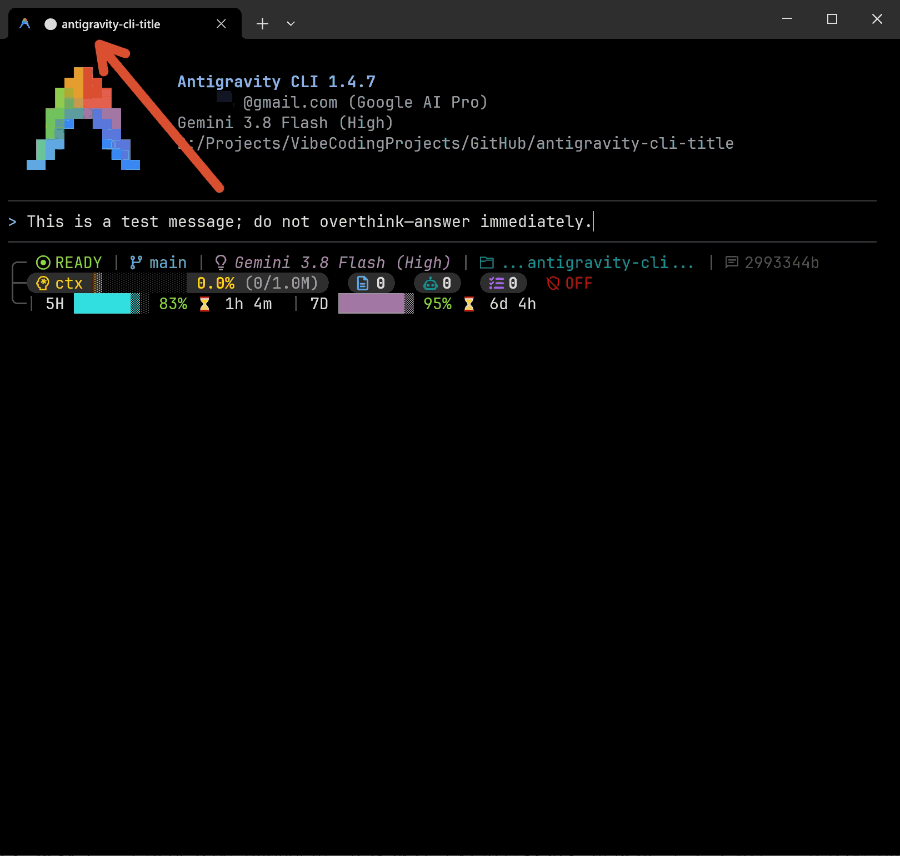
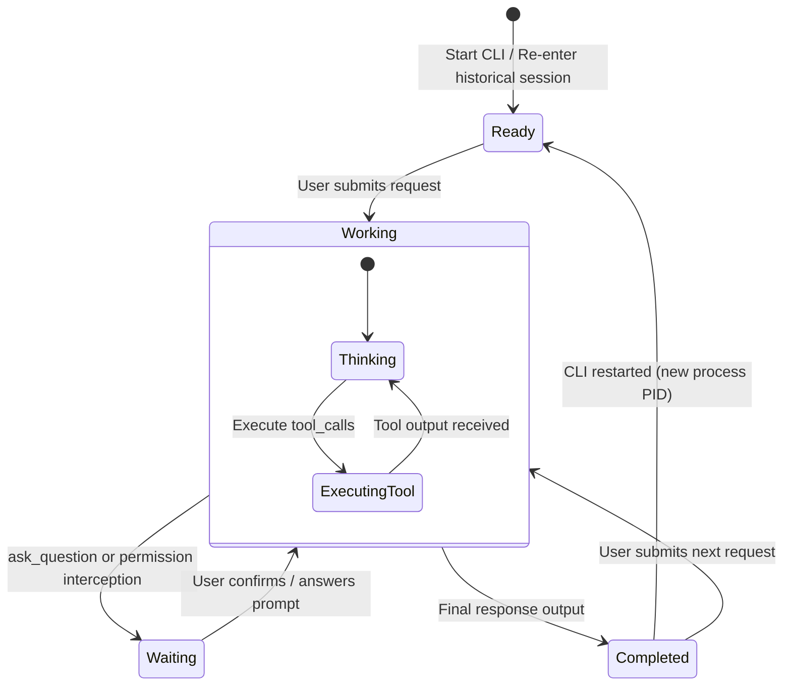

# Antigravity CLI Window Title (`antigravity-cli-title`)

<p align="center">
  <b>Dynamic, State-Aware Window Title Indicator for Google Antigravity CLI (<code>agy</code>)</b>
</p>

<p align="center">
  <a href="LICENSE"></a>
  <a href="https://github.com/google-antigravity/antigravity-cli"></a>
  
</p>

<p align="center">
  <b>English</b> | <a href="README.zh-CN.md">简体中文</a>
</p>

<p align="center">
  
</p>

---

## 💡 Why `antigravity-cli-title`?

When working across multiple terminal tabs or windows in parallel, switching between tasks makes it difficult to track which session is still running, which one finished, and which one is blocked waiting for your input.

Existing solutions (like bottom statuslines) only work when the window is in the foreground. Default title scripts treat waiting for user approval as ordinary tool execution, causing background sessions to appear busy when they are actually halted.

**`antigravity-cli-title`** implements a **4-state lifecycle state machine** directly in your terminal tab / window title:

```
[Window Tab]  agy: ⚪ Docker compose setup            <- Idle / waiting for first instruction
[Window Tab]  agy: ⚙️ Fix user login issue            <- Currently thinking / executing
[Window Tab]  agy: ⚠️ Deploy to production            <- Blocked! Waiting for your confirmation
[Window Tab]  agy: ✅ Refactor database schema        <- Finished! Ready for review
```

---

## ✨ Key Features

- **🎯 Complete 4-State Machine**:
  - `⚪ Ready`: Clean initial state after launching or reopening a historical conversation.
  - `⚙️ Working`: Actively thinking, reading files, executing commands, background tasks (Tasks), or subagents (Subagents).
  - `⚠️ Waiting`: Interactively waiting for user input (`ask_question`) or permission approvals (`permissions.ask`, returns to Working once authorized).
  - `✅ Completed`: Remains marked as done after outputting the final response and all background tasks/subagents finish.
- **⚡ Background & Interruption Awareness**:
  - Deep-parses `transcript.jsonl` tails and `settings.json` permission rules, linking active tasks/subagents and native process trees to accurately distinguish running jobs from authorization prompts.
- **🪟 Multi-Window Isolation**:
  - Binds conversation IDs with active CLI process lifecycles. Zero cross-window state pollution.
- **🏷️ Intelligent Title Hierarchy**:
  - `conversation_title` ➔ First user request (smartly truncated) ➔ Current workspace directory name.
- **🚀 Ultra-Fast Native Execution Engine (`title.exe`)**:
  - Pure Go native renderer with zero external dependencies, directly invoking Windows system APIs (`NtQueryInformationProcess`, `winsqlite3.dll`) with low process overhead.
  - Automatically installed, compiled, or downloaded via `install.ps1`.
- **🌐 Cross-Platform Native Support**:
  - Universal **Go native binary (`title.exe` / `title`)** for Windows, Linux, and macOS.
  - The renderer does not require Python or PowerShell; the POSIX installer uses Python 3 or jq to merge existing settings safely.

---

## 📊 State Reference Table

| Status Indicator | Text Mode | Agent Phase | What It Means |
| :---: | :---: | :--- | :--- |
| **`⚪`** | `[READY]` | **Initial / Idle** | Fresh session opened or historical session restored; waiting for user prompt. |
| **`⚙️`** | `[WORKING]` | **Thinking / Tool Use** | Agent is thinking, analyzing code, running tests, or executing commands. |
| **`⚠️`** | `[WAITING]` | **User Interaction Blocked** | Agent called `ask_question` or triggered a sensitive permission prompt requiring user confirmation. |
| **`✅`** | `[DONE]` | **Completed** | Agent completed all work for this turn and finished responding. Stays done until next input. |

---

## 🚀 Quick Start

### Windows (PowerShell)

Run the following command in PowerShell:

```powershell
# 1. Basic one-line installation (clean mode, title engine only)
irm https://raw.githubusercontent.com/kjqg-cn/antigravity-cli-title/main/install.ps1 | iex

# 2. Recommended: One-line install with dedicated Windows Terminal Profile (official Logo + agy auto-launcher)
& ([scriptblock]::Create((irm https://raw.githubusercontent.com/kjqg-cn/antigravity-cli-title/main/install.ps1))) -WTProfile
```

> [!TIP]
> If already installed, running the command with `-WTProfile` at any time will **safely and incrementally enable the Profile** while preserving all existing custom configurations.

*Or install locally from source:*

```powershell
git clone https://github.com/kjqg-cn/antigravity-cli-title.git
cd antigravity-cli-title
powershell.exe -ExecutionPolicy Bypass -File .\install.ps1

# Local install with Profile
powershell.exe -ExecutionPolicy Bypass -File .\install.ps1 -WTProfile
```
> [!NOTE]
> Under default Windows PowerShell (5.1) execution policies (`Restricted`), running with `-ExecutionPolicy Bypass` ensures script execution succeeds without modifying system-wide security settings.

### Linux / macOS (Bash)

Run the following command in your terminal:

```bash
# One-line installation via GitHub
curl -fsSL https://raw.githubusercontent.com/kjqg-cn/antigravity-cli-title/main/install.sh | bash
```

*Or install locally from source:*

```bash
git clone https://github.com/kjqg-cn/antigravity-cli-title.git
cd antigravity-cli-title
./install.sh
```

### 🎛️ Installer Parameters & Options

Both `install.ps1` and `install.sh` support passing parameters directly during installation or upgrades.

#### Windows (`install.ps1`)
| Parameter | Default | Description |
| :--- | :--- | :--- |
| `-WTProfile` | Off | Automatically configures Windows Terminal profile and smart router. |
| `-Animate` / `-NoAnimate` | Off | Enables Windows title animation, or disables it during reinstall. |
| `-NoPrefix` | Off | Hides the leading `agy: ` prefix. To disable an inherited `--no-prefix` on reinstall, pass `-ShowPrefix`. |
| `-Prefix <string>` | `"agy:"` | Customizes the prefix tag. |
| `-Text` | Off | Uses text status tags (e.g. `[READY]`, `[DONE]`) instead of emojis. |
| `-MaxLength <int>` | `35` | Maximum title length before truncation. |
| `-TaskTimeout <int>` | `60` | Background task silence threshold (in seconds) before auto-releasing to DONE. |
| `-ReadySymbol <str>` | `""` | Custom Ready indicator. |
| `-WorkingSymbol <str>`| `""` | Custom Working indicator. |
| `-WaitingSymbol <str>`| `""` | Custom Waiting indicator (e.g. `🔔`). |
| `-DoneSymbol <str>` | `""` | Custom Done indicator. |

*Examples:*
```powershell
# Online install with parameters:
& ([scriptblock]::Create((irm https://raw.githubusercontent.com/kjqg-cn/antigravity-cli-title/main/install.ps1))) -WTProfile -WaitingSymbol "🔔"

# Reinstall and explicitly turn off previously inherited --no-prefix:
powershell.exe -ExecutionPolicy Bypass -File .\install.ps1 -WTProfile -ShowPrefix
```

> [!NOTE]
> **PowerShell Session Scoping**: Running `irm ... | iex` executes in the caller's session, where top-level parameter declarations like `$Prefix` can bind into the caller scope. When passing custom arguments or to avoid any caller session variable pollution, always prefer `& ([scriptblock]::Create((irm ...))) -Param ...` or execute via `-File .\install.ps1`.

#### Linux / macOS (`install.sh`)
| Option | Default | Description |
| :--- | :--- | :--- |
| `--no-prefix` / `--no-prefix=true` | Off | Hides the leading `agy: ` prefix. |
| `--show-prefix` / `--no-prefix=false` | - | Re-enables the prefix tag (overriding previously inherited `--no-prefix`). |
| `--text` / `--classic` | Off | Uses text status tags instead of emojis. |
| `--animate` / `--no-animate` | Off | Preserves the animation option in configuration; POSIX titles remain static. |
| `--no-text` / `--emoji` / `--text=false`| - | Uses emoji status indicators (overriding previously inherited `--text`). |
| `--prefix=<str>` | `"agy:"` | Customizes the prefix tag. |
| `--max-length=<n>` | `35` | Maximum title length before truncation. |
| `--task-timeout=<n>` | `60` | Task silence threshold (seconds). |
| `--ready=<str>` | `""` | Custom Ready indicator. |
| `--working=<str>` | `""` | Custom Working indicator. |
| `--waiting=<str>` | `""` | Custom Waiting indicator. |
| `--done=<str>` | `""` | Custom Done indicator. |

*Examples:*
```bash
# Online install with arguments:
curl -fsSL https://raw.githubusercontent.com/kjqg-cn/antigravity-cli-title/main/install.sh | bash -s -- --show-prefix --waiting="🔔"

# Local install with custom options:
./install.sh --show-prefix --text
```

---

## ⚙️ Configuration & Options

The installation automatically updates `~/.gemini/antigravity-cli/settings.json`:

```json
{
  "title": {
    "type": "command",
    "command": "C:/Users/YourName/.gemini/antigravity-cli-title/title.exe",
    "enabled": true
  }
}
```

### Optional Working Title Animation (Windows)

Add `--animate` to your existing `title.command`, or install locally with:

```powershell
powershell.exe -ExecutionPolicy Bypass -File .\install.ps1 -Animate
```

Working cycles through `⠋ ⠙ ⠹ ⠸ ⠼ ⠴ ⠦ ⠧ ⠇ ⠏` every 100ms. A separate native worker updates the console title, including while long commands produce no telemetry. Waiting, Ready and Done stay static. The terminal profile icon is preserved; OSC 9;4 is not used.

Animation is off by default. `--text` and a nonblank `--working` symbol keep the static display. Linux/macOS accept `--animate` in both the renderer and installer and retain static titles. Remove `--animate` from `title.command` to stop it, or reinstall with `-NoAnimate` (also works with Windows PowerShell 5.1 `-File`). The worker polls only the settings file selected by its callback; CLI-only animation ignores unrelated default settings.

The renderer also accepts `--animate=true`, `--animate=false` and `--no-animate`; the last animation flag wins. If the selected settings file disappears, its worker restores the static title and stops at the next settings poll.

Workers are isolated by the agy PID and creation time, exit when that process exits, and fall back to the normal title if they cannot attach to its console. Native console API behavior is tested; visual rendering in each terminal still depends on its title settings (including `suppressApplicationTitle`).

Configuration hot reload applies to callbacks launched by agy and this renderer's `title.command`. A direct manual invocation uses its own CLI flags.

### Custom State Symbols & Instant Hot-Reload

You can specify symbols via installer parameters (e.g. `-WaitingSymbol 🔔`) or append flags to the `command` field in `settings.json`:

```json
{
  "title": {
    "type": "command",
    "command": "C:/Users/YourName/.gemini/antigravity-cli-title/title.exe --no-prefix --waiting 🔔 --working ⚡",
    "enabled": true
  }
}
```

> [!NOTE]
> **Instant Hot-Reload (0 Restart Needed)**: `title.exe` dynamically parses the latest arguments in `settings.json`'s `command` field on every single telemetry event. Changes take effect on the very next action without restarting `agy`!
>
> **Why avoid standalone JSON properties?**: Antigravity CLI enforces a strict whitelist struct schema when rewriting `settings.json` upon CLI restarts or config updates, which automatically purges unknown custom properties. Configuring parameters inside the native `command` field is the only persistent, wipe-proof approach.

| Flag | Example | Description |
| :--- | :--- | :--- |
| `--animate` / `--no-animate` | `title.exe --animate` | Enables/disables the optional Working spinner animation on Windows (`--animate=true` / `--animate=false` supported; overridden by `--text` or non-blank `--working`). |
| `--no-prefix` | `title.exe --no-prefix` | Hides the leading `agy: ` tag (output: `✅ Refactor login`). |
| `--prefix <str>` | `title.exe --prefix 🤖` | Customizes the prefix tag. |
| `--text` / `--classic` | `title.exe --text` | Uses ASCII text indicators like `[DONE]` instead of emojis. |
| `--max-length <n>` | `title.exe --max-length 40` | Sets max character length for truncated titles (default: 35). |
| `--task-timeout <n>` | `title.exe --task-timeout 60` | Background task silence threshold in seconds before auto-releasing to DONE (default: 60). |
| `--ready <str>` | `title.exe --ready 💤` | Overrides Ready state symbol/indicator (default: `⚪` or `[READY]`). |
| `--working <str>` | `title.exe --working ⚡` | Overrides Working state symbol/indicator (default: `⚙️` or `[WORKING]`). |
| `--waiting <str>` | `title.exe --waiting 🔔` | Overrides Waiting state symbol/indicator (default: `⚠️` or `[WAITING]`). |
| `--done <str>` | `title.exe --done 🎉` | Overrides Done state symbol/indicator (default: `✅` or `[DONE]`). |

> [!TIP]
> **Zero-Backslash Safety**: When configuring flags in the `command` string, standard single emojis or words without whitespace **do not need quotes** (e.g. `--waiting 🔔`). This completely eliminates harmful `\"` backslash escapes inside JSON strings. Only use quotes when values contain spaces (e.g. `--prefix "My Bot"`).

---

## 🏗️ State Machine Architecture



---

## 🗑️ Uninstallation

To remove the title configuration and restore your previous settings:

### Windows:
```powershell
# Run the uninstaller directly from the installation directory:
powershell.exe -ExecutionPolicy Bypass -File "$HOME\.gemini\antigravity-cli-title\uninstall.ps1"

# To completely purge the installation directory and all markers:
powershell.exe -ExecutionPolicy Bypass -File "$HOME\.gemini\antigravity-cli-title\uninstall.ps1" -Purge
```
*(Or run `powershell.exe -ExecutionPolicy Bypass -File .\uninstall.ps1 [-Purge]` from the cloned repository)*

### Linux / macOS:
```bash
# Run the uninstaller directly from the installation directory:
~/.gemini/antigravity-cli-title/uninstall.sh

# To completely purge the installation directory and all markers:
~/.gemini/antigravity-cli-title/uninstall.sh --purge
```
*(Or run `./uninstall.sh [--purge]` from the cloned repository)*

---

## 🤝 Ecosystem Pairing

For the ultimate terminal AI development experience, pair **`antigravity-cli-title`** with:
- **[`antigravity-cli-statusline`](https://github.com/weby-homelab/antigravity-cli-statusline)**: Full developer telemetry dashboard (Git status, context bar, tokens, quotas) at the bottom of your screen.

---

## 📄 License

This project is open-source under the [MIT License](LICENSE).
