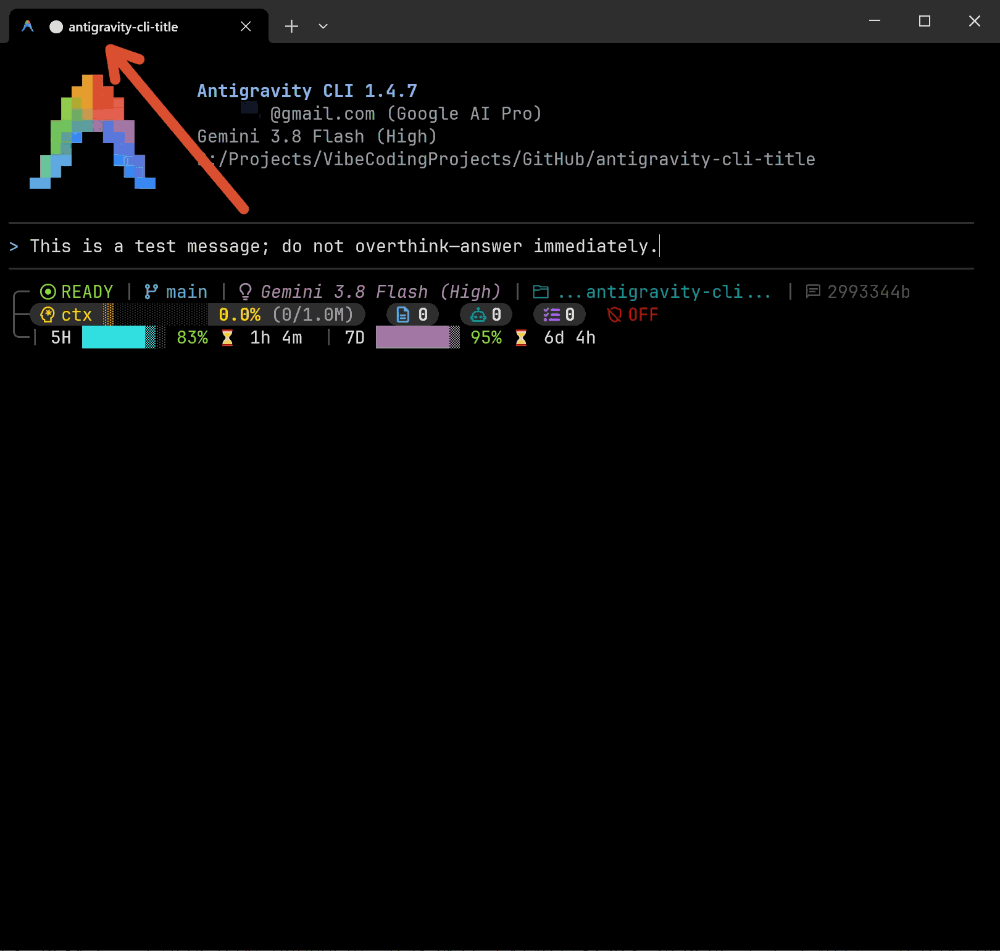
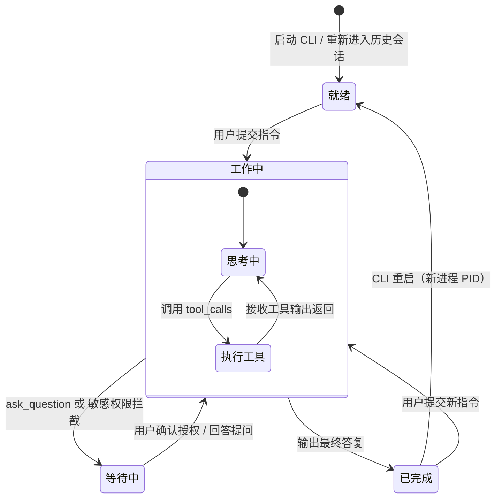

# Antigravity CLI 窗口标题指示器 (`antigravity-cli-title`)

<p align="center">
  <b>Google Antigravity CLI (<code>agy</code>) 终端窗口标题动态感知与生命周期状态指示器</b>
</p>

<p align="center">
  <a href="LICENSE"></a>
  <a href="https://github.com/google-antigravity/antigravity-cli"></a>
  
</p>

<p align="center">
  <a href="README.md">English</a> | <b>简体中文</b>
</p>

<p align="center">
  
</p>

---

## 💡 为什么需要 `antigravity-cli-title`？

在多个终端标签页（Tabs）或独立窗口中并行协作时，频繁切换上下文往往难以分辨：**哪个会话仍在运行、哪个已执行完毕、哪个正卡在交互提示等待你的确认**。

现有的解决方案（例如底部状态栏 statusline）仅在窗口置于前台时可见；而原生的 CLI 标题脚本将“等待用户确认”笼统归为工具执行阶段，导致被挂起等待的后台会话看起来依然显示为繁忙。

**`antigravity-cli-title`** 直接在你的终端标签页 / 窗口标题栏中实现了一套完整的 **4 状态生命周期状态机**：

```
[窗口标签]  agy: ⚪ Docker compose setup            <- 就绪 / 等待首次输入
[窗口标签]  agy: ⚙️ Fix user login issue            <- 正在思考 / 执行工具
[窗口标签]  agy: ⚠️ Deploy to production            <- 已阻断！等待确认或输入
[窗口标签]  agy: ✅ Refactor database schema        <- 执行完成！等待查看结果
```

---

## ✨ 核心特性

- **🎯 完整的 4 状态生命周期状态机**：
  - `⚪ 就绪 (Ready)`：新会话启动或重新加载历史会话后的初始干净状态。
  - `⚙️ 工作中 (Working)`：正在深度思考、读取文件、分析代码或执行命令、后台异步任务（Tasks）与子代理（Subagents）。
  - `⚠️ 等待中 (Waiting)`：触发交互等待（如 `ask_question`）或敏感权限门禁（`permissions.ask`，命令放行后自动切回工作中）。
  - `✅ 已完成 (Completed)`：当前轮次任务及后台子代理/任务全部完成；保持完成态直至提交新请求。
- **⚡ 后台与中断精确感知**：
  - 增量解析 `transcript.jsonl` 尾部与 `settings.json` 权限配置，联动子代理/任务计数与原生进程树，毫秒级区分“正常工具/后台执行”与“需要人工介入的授权阻塞”。
- **🪟 多窗口/多标签严格隔离**：
  - 将会话 ID 与活跃 CLI 进程生命周期精准绑定，原生进程树回溯机制，跨窗口绝不串台或状态污染。
- **🏷️ 智能标题多级回退**：
  - 优先读取 `conversation_title` ➔ 回退至用户首句输入（智能截断） ➔ 回退至当前工作区目录名。
- **🚀 原生超高速执行引擎 (`title.exe`)**：
  - 基于纯 Go 构建的高性能执行引擎，零第三方依赖，直调 Windows 系统级 API（`NtQueryInformationProcess` 与 `winsqlite3.dll`），避免 PowerShell 冷启动开销。
  - `install.ps1` 安装器会自动优先在本地编译或从 GitHub Release 下载预编译的 `title.exe`。
- **🌐 全平台原生极速支持**：
  - Windows、Linux、macOS 全平台统一 **Go 原生编译二进制 (`title.exe` / `title`)**。
  - 渲染器无 Python/PowerShell 运行时依赖；POSIX 安装器合并已有配置时需要 Python 3 或 jq。

---

## 📊 状态速查表

| 状态指示符 | 纯文本模式 | 对应阶段 | 含义解释 |
| :---: | :---: | :--- | :--- |
| **`⚪`** | `[READY]` | **初始就绪 / 空闲** | 新会话刚刚启动，或重开旧历史会话；等待用户输入提示词。 |
| **`⚙️`** | `[WORKING]` | **思考中 / 工具执行** | Agent 正在深度思考、分析代码、运行测试或执行 Shell 命令。 |
| **`⚠️`** | `[WAITING]` | **交互阻断 / 待确认** | Agent 调用了 `ask_question`，或触发了需人工授权的敏感权限提示。 |
| **`✅`** | `[DONE]` | **当前轮次完成** | Agent 完成本轮所有工作并输出最终答复。持续保持直到提交下一次输入。 |

---

## 🚀 快速上手

### Windows (PowerShell)

在 PowerShell 中执行以下命令一键安装：

```powershell
# 1. 基础一键安装（纯净模式，仅安装标题管理器）
irm https://raw.githubusercontent.com/kjqg-cn/antigravity-cli-title/main/install.ps1 | iex

# 2. 推荐：一键安装并自动配置 Windows Terminal 专属 Profile（官方彩色 Logo + 敲 agy 自动唤起）
& ([scriptblock]::Create((irm https://raw.githubusercontent.com/kjqg-cn/antigravity-cli-title/main/install.ps1))) -WTProfile
```

> [!TIP]
> 如果此前已安装过，任何时候运行带 `-WTProfile` 的命令均可**安全增量开启 Profile**，已有的自定义配置将 100% 完整保留。

*或者克隆源码本地安装：*

```powershell
git clone https://github.com/kjqg-cn/antigravity-cli-title.git
cd antigravity-cli-title
powershell.exe -ExecutionPolicy Bypass -File .\install.ps1

# 本地带 Profile 安装
powershell.exe -ExecutionPolicy Bypass -File .\install.ps1 -WTProfile
```
> [!NOTE]
> Windows PowerShell (5.1) 默认策略为 `Restricted`，附加 `-ExecutionPolicy Bypass` 可在不更改系统全局安全策略的前提下顺利执行安装脚本。

### Linux / macOS (Bash)

在终端中执行以下命令一键安装：

```bash
# 通过 GitHub 一键在线安装
curl -fsSL https://raw.githubusercontent.com/kjqg-cn/antigravity-cli-title/main/install.sh | bash
```

*或者克隆源码本地安装：*

```bash
git clone https://github.com/kjqg-cn/antigravity-cli-title.git
cd antigravity-cli-title
./install.sh
```

### 🎛️ 安装脚本参数与选项

`install.ps1` 与 `install.sh` 均支持在安装或升级时直接传参定制。

#### Windows (`install.ps1`)
| 参数 | 默认值 | 说明 |
| :--- | :--- | :--- |
| `-WTProfile` | 关闭 | 自动配置 Windows Terminal 专属 Profile 与智能路由。 |
| `-Animate` / `-NoAnimate` | 关闭 | 启用 Windows 标题动画，或在重装时停用。 |
| `-NoPrefix` | 关闭 | 隐藏标题开头的 `agy: ` 前缀。若需在重装时关掉先前继承的 `--no-prefix`，显式传入 `-ShowPrefix` 即可。 |
| `-Prefix <string>` | `"agy:"` | 自定义前缀标签。 |
| `-Text` | 关闭 | 使用纯文本状态标识（如 `[READY]`, `[DONE]`）替代 Emoji。 |
| `-MaxLength <int>` | `35` | 标题超长截断字符数上限。 |
| `-TaskTimeout <int>` | `60` | 后台静默任务自动转为完成状态的超时阈值（秒）。 |
| `-ReadySymbol <str>` | `""` | 自定义 Ready 状态符号。 |
| `-WorkingSymbol <str>`| `""` | 自定义 Working 状态符号。 |
| `-WaitingSymbol <str>`| `""` | 自定义 Waiting 状态符号（如 `🔔`）。 |
| `-DoneSymbol <str>` | `""` | 自定义 Done 状态符号。 |

*调用示例：*
```powershell
# 在线带参安装：
& ([scriptblock]::Create((irm https://raw.githubusercontent.com/kjqg-cn/antigravity-cli-title/main/install.ps1))) -WTProfile -WaitingSymbol "🔔"

# 重新安装并显式关闭先前继承的 --no-prefix：
powershell.exe -ExecutionPolicy Bypass -File .\install.ps1 -WTProfile -ShowPrefix
```

> [!NOTE]
> **PowerShell 作用域提示**：使用 `irm ... | iex` 时，脚本运行在调用方顶级会话中，顶层 `param` 变量（如 `$Prefix`）会进入调用方作用域。如需传参或避免变量污染，推荐使用 `& ([scriptblock]::Create((irm ...))) -参数` 或下载后以 `-File .\install.ps1` 执行。

#### Linux / macOS (`install.sh`)
| 选项 | 默认值 | 说明 |
| :--- | :--- | :--- |
| `--no-prefix` / `--no-prefix=true` | 关闭 | 隐藏开头的 `agy: ` 前缀。 |
| `--show-prefix` / `--no-prefix=false` | - | 重新启用前缀（覆盖之前继承的 `--no-prefix`）。 |
| `--text` / `--classic` | 关闭 | 使用纯文本状态标识替代 Emoji。 |
| `--animate` / `--no-animate` | 关闭 | 在配置中保留或移除动画选项；POSIX 标题保持静态。 |
| `--no-text` / `--emoji` / `--text=false`| - | 使用 Emoji 状态标识（覆盖之前继承的 `--text`）。 |
| `--prefix=<str>` | `"agy:"` | 自定义前缀标签。 |
| `--max-length=<n>` | `35` | 标题超长截断字符数上限。 |
| `--task-timeout=<n>` | `60` | 后台静默任务超时阈值（秒）。 |
| `--ready=<str>` | `""` | 自定义 Ready 状态符号。 |
| `--working=<str>` | `""` | 自定义 Working 状态符号。 |
| `--waiting=<str>` | `""` | 自定义 Waiting 状态符号。 |
| `--done=<str>` | `""` | 自定义 Done 状态符号。 |

*调用示例：*
```bash
# 在线带参安装：
curl -fsSL https://raw.githubusercontent.com/kjqg-cn/antigravity-cli-title/main/install.sh | bash -s -- --show-prefix --waiting="🔔"

# 本地带参安装：
./install.sh --show-prefix --text
```

---

## ⚙️ 配置与可选参数

安装程序会自动配置 `~/.gemini/antigravity-cli/settings.json`：

```json
{
  "title": {
    "type": "command",
    "command": "C:/Users/YourName/.gemini/antigravity-cli-title/title.exe",
    "enabled": true
  }
}
```

### 可选的工作中标题动画（Windows）

在现有 `title.command` 中追加 `--animate`，或本地安装时传入：

```powershell
powershell.exe -ExecutionPolicy Bypass -File .\install.ps1 -Animate
```

Working 状态每 100ms 轮换 `⠋ ⠙ ⠹ ⠸ ⠼ ⠴ ⠦ ⠧ ⠇ ⠏`。独立原生辅助进程更新控制台标题，长命令没有新 telemetry 时也持续播放。Waiting、Ready、Done 保持静态；保留标签 Logo，不使用 OSC 9;4。

动画默认关闭。`--text` 或非空白的自定义 `--working` 符号优先保留静态显示。Linux/macOS 的渲染器和安装器均接受 `--animate`，保持静态标题。删除 `title.command` 中的 `--animate`，或重装时传入 `-NoAnimate` 即可停用（兼容 Windows PowerShell 5.1 的 `-File` 调用）。辅助进程只轮询本次回调选用的配置文件；仅由 CLI 参数启用的动画不读取无关的默认配置。

渲染器也接受 `--animate=true`、`--animate=false` 和 `--no-animate`；后出现的动画开关优先。若选定的配置文件消失，辅助进程会在下一次配置轮询时恢复静态标题并退出。

若配置在写入期间暂时为空、不完整或无法读取，辅助进程会保留当前动画，并在下一轮配置轮询时重试；合法配置中移除或禁用动画仍会正常停播。

回调和辅助进程使用相同的时间相位计算动画帧，Working 更新不再先显示静态齿轮。收到明确的 idle 遥测、且只剩后台任务时，辅助进程约每秒复查一次任务日志，超过 `--task-timeout` 静默时长后转为 Done，无需等待下一次回调。前台工作或活跃子代理不会仅因遥测静默而被判定完成。

若仍遇到 Done 延迟，可临时在 `title.command` 中追加 `--trace-state`。元数据写入 `~/.gemini/antigravity-cli-title/diagnostic_<pid>_<创建时间>.jsonl`（每个进程最多约 1 MiB）：包含收到的状态、活跃任务/子代理数量、状态判定原因及发布失败原因；不记录提示词、命令、文件正文或标题。采样后移除该参数即可。缺少最终 idle 事件或子代理状态滞后仍需真实遥测确认，辅助进程不会凭静默猜测完成。

Windows 安装与卸载恢复时，只格式化插入或恢复的 `title` 块，沿用原文件的顶层缩进和换行符；新文件默认每层两个空格。其他 JSON 字面量和排版保留原文。

辅助进程按 agy PID 与创建时间隔离，随该进程退出；无法附加控制台时保留普通标题。已验证原生控制台 API 行为，各终端的实际视觉呈现仍受标题设置（含 `suppressApplicationTitle`）影响。

配置热加载仅用于 agy 启动且指向本渲染器的标题回调；独立手工运行遵循本次 CLI 参数。

### 自定义状态标识与即时热重载（Hot-Reload）

你可以直接通过安装脚本传参（如 `-WaitingSymbol 🔔`），或在 `settings.json` 的 `command` 字段中追加参数来自由定制各状态指示器：

```json
{
  "title": {
    "type": "command",
    "command": "C:/Users/YourName/.gemini/antigravity-cli-title/title.exe --no-prefix --waiting 🔔 --working ⚡",
    "enabled": true
  }
}
```

> [!NOTE]
> **免重启即时热生效（Hot-Reload）**：`title.exe` 在运行时会实时动态解析 `settings.json` 中 `command` 的最新参数。修改保存后，**下一个动作立即换用新图标，完全无需重启 `agy`**！
>
> **为什么不配置独立 JSON 属性？**：官方 `agy` 拥有强类型结构体白名单序列化机制，在会话重启或更新配置写盘时，会将未在官方结构体中声明的未知 key 自动清除。因此将参数安全配置在官方合法的 `command` 字段中是最稳固、防清洗的标准实践。

| 参数选项 | 示例 | 作用说明 |
| :--- | :--- | :--- |
| `--animate` / `--no-animate` | `title.exe --animate` | 在 Windows 上启用或停用工作中旋转动画（同时支持 `--animate=true` / `--animate=false`；开启 `--text` 或非空白 `--working` 时保持静态）。 |
| `--no-prefix` | `title.exe --no-prefix` | 隐藏开头的 `agy: ` 标识（显示如：`✅ Refactor login`）。 |
| `--prefix <str>` | `title.exe --prefix 🤖` | 自定义前缀标识符。 |
| `--text` / `--classic` | `title.exe --text` | 使用 `[DONE]` 等纯 ASCII 文本指示器替代 Emoji 图标。 |
| `--max-length <n>` | `title.exe --max-length 40` | 设置标题截断的最大字符长度（默认：35）。 |
| `--task-timeout <n>` | `title.exe --task-timeout 60` | 后台异步任务输出静默超时（秒），超过此时间无新输出自动解除阻塞进入 DONE（默认：60）。 |
| `--ready <str>` | `title.exe --ready 💤` | 自定义就绪（Ready）状态图标/字符（默认：`⚪` 或 `[READY]`）。 |
| `--working <str>` | `title.exe --working ⚡` | 自定义运行中（Working）状态图标/字符（默认：`⚙️` 或 `[WORKING]`）。 |
| `--waiting <str>` | `title.exe --waiting 🔔` | 自定义等待审批/交互（Waiting）状态图标/字符（默认：`⚠️` 或 `[WAITING]`）。 |
| `--done <str>` | `title.exe --done 🎉` | 自定义完成（Done）状态图标/字符（默认：`✅` 或 `[DONE]`）。 |

> [!TIP]
> **零反斜杠安全规范**：在 `command` 命令行中配置时，常规单个 Emoji 或无空格的字符**无需添加任何引号**（直接写 `--waiting 🔔` 即可），这样可彻底杜绝在 JSON 内部产生 `\"` 转义反斜杠；仅当参数值包含空格（如 `--prefix "My Bot"`）时才需要引号包裹。

---

## 🏗️ 状态机架构图



---

## 🗑️ 卸载说明

如需移除标题栏配置并恢复原有设置：

### Windows：
```powershell
# 直接运行已安装目录中的卸载脚本：
powershell.exe -ExecutionPolicy Bypass -File "$HOME\.gemini\antigravity-cli-title\uninstall.ps1"

# 若需彻底清除安装目录及所有历史状态标记：
powershell.exe -ExecutionPolicy Bypass -File "$HOME\.gemini\antigravity-cli-title\uninstall.ps1" -Purge
```
*(或者在克隆的源码仓库中执行 `powershell.exe -ExecutionPolicy Bypass -File .\uninstall.ps1 [-Purge]`)*

### Linux / macOS：
```bash
# 直接运行已安装目录中的卸载脚本：
~/.gemini/antigravity-cli-title/uninstall.sh

# 若需彻底清除安装目录及所有历史状态标记：
~/.gemini/antigravity-cli-title/uninstall.sh --purge
```
*(或者在克隆的源码仓库中执行 `./uninstall.sh [--purge]`)*

---

## 🤝 生态搭配推荐

想要获取极致的终端 AI 开发体验，推荐将 **`antigravity-cli-title`** 搭配以下插件使用：
- **[`antigravity-cli-statusline`](https://github.com/weby-homelab/antigravity-cli-statusline)**：位于屏幕底部的全功能开发者遥测面板（实时展示 Git 分支状态、上下文占用条、Token 与配额用量等）。

---

## 📄 开源许可

本项目遵循 [MIT License](LICENSE) 开源协议。
