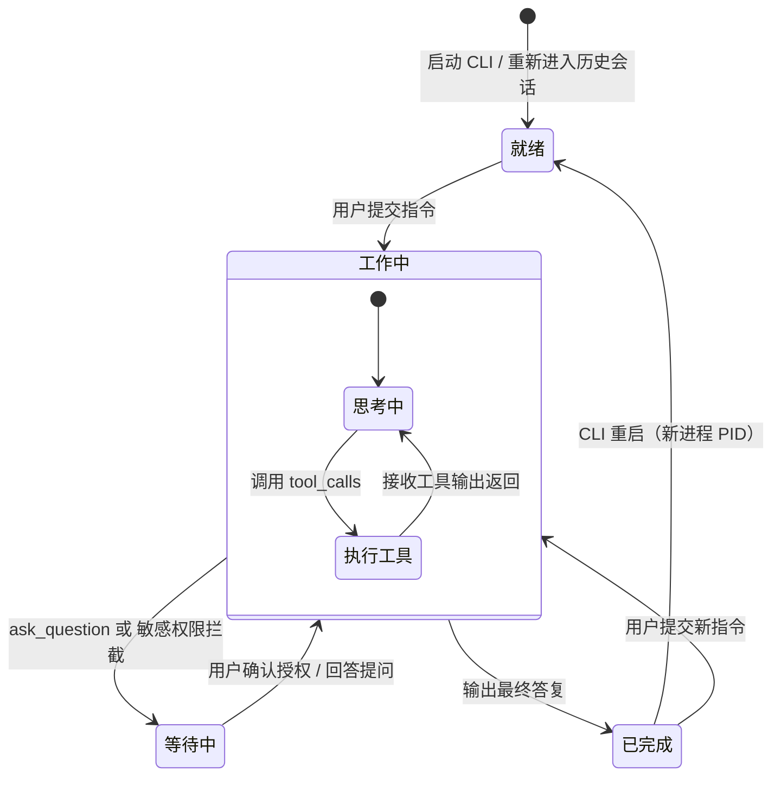

# Antigravity CLI 窗口标题指示器 (`antigravity-cli-title`)

<p align="center">
  <b>Google Antigravity CLI (<code>agy</code>) 终端窗口标题动态感知与生命周期状态指示器</b>
</p>

<p align="center">
  <a href="LICENSE"></a>
  <a href="https://github.com/google-antigravity/antigravity-cli"></a>
  
</p>

<p align="center">
  <a href="README.md">English</a> | <b>简体中文</b>
</p>

<p align="center">
  
</p>

---

## 💡 为什么需要 `antigravity-cli-title`？

在多个终端标签页（Tabs）或独立窗口中并行协作时，频繁切换上下文往往难以分辨：**哪个会话仍在运行、哪个已执行完毕、哪个正卡在交互提示等待你的确认**。

现有的解决方案（例如底部状态栏 statusline）仅在窗口置于前台时可见；而原生的 CLI 标题脚本将“等待用户确认”笼统归为工具执行阶段，导致被挂起等待的后台会话看起来依然显示为繁忙。

**`antigravity-cli-title`** 直接在你的终端标签页 / 窗口标题栏中实现了一套完整的 **4 状态生命周期状态机**：

```
[窗口标签]  agy: ⚙️ Fix user login issue           <- 正在思考 / 执行工具
[窗口标签]  agy: ⚠️ Deploy to production           <- 已阻断！等待确认或输入
[窗口标签]  agy: ✅ Refactor database schema        <- 执行完成！等待查看结果
[窗口标签]  agy: ⚪ Docker compose setup            <- 就绪 / 等待首次输入
```

---

## ✨ 核心特性

- **🎯 完整的 4 状态生命周期状态机**：
  - `⚪ 就绪 (Ready)`：新会话启动或重新加载历史会话后的初始干净状态。
  - `⚙️ 工作中 (Working)`：正在深度思考、读取文件、分析代码或执行后台工具。
  - `⚠️ 等待中 (Waiting)`：触发交互等待（如 `ask_question`）或敏感权限确认（`permissions.ask`）。
  - `✅ 已完成 (Completed)`：当前轮次任务全部完成并输出最终答复；保持完成态直至提交新请求。
- **⚡ 后台与中断精确感知**：
  - 增量解析 `transcript.jsonl` 尾部与 `settings.json` 权限配置，毫秒级区分“正常工具执行”与“需要人工介入的授权阻塞”。
- **🪟 多窗口/多标签严格隔离**：
  - 将会话 ID 与活跃 CLI 进程生命周期精准绑定，原生进程树回溯机制，跨窗口绝不串台或状态污染。
- **🏷️ 智能标题多级回退**：
  - 优先读取 `conversation_title` ➔ 回退至用户首句输入（智能截断） ➔ 回退至当前工作区目录名。
- **🚀 零感延迟与高性能**：
  - 高速进程 ID 缓存与轻量解析，对终端操作毫无延迟干扰；纯非阻塞异步更新。
- **🌐 全平台原生支持**：
  - 原生 **PowerShell** 渲染器（针对 Windows 环境强化 UTF-8 BOM 兼容性）。
  - 原生 **POSIX Bash** 渲染器（支持 Linux 与 macOS）。

---

## 📊 状态速查表

| 状态指示符 | 纯文本模式 | 对应阶段 | 含义解释 |
| :---: | :---: | :--- | :--- |
| **`⚪`** | `[READY]` | **初始就绪 / 空闲** | 新会话刚刚启动，或重开旧历史会话；等待用户输入提示词。 |
| **`⚙️`** | `[WORKING]` | **思考中 / 工具执行** | Agent 正在深度思考、分析代码、运行测试或执行 Shell 命令。 |
| **`⚠️`** | `[WAITING]` | **交互阻断 / 待确认** | Agent 调用了 `ask_question`，或触发了需人工授权的敏感权限提示。 |
| **`✅`** | `[DONE]` | **当前轮次完成** | Agent 完成本轮所有工作并输出最终答复。持续保持直到提交下一次输入。 |

---

## 🚀 快速上手

### Windows (PowerShell)

在 PowerShell 中执行以下命令一键安装：

```powershell
# 通过 GitHub 一键在线安装
irm https://raw.githubusercontent.com/kjqg-cn/antigravity-cli-title/main/install.ps1 | iex
```

*或者克隆源码本地安装：*

```powershell
git clone https://github.com/kjqg-cn/antigravity-cli-title.git
cd antigravity-cli-title
.\install.ps1
```

### Linux / macOS (Bash)

在终端中执行以下命令一键安装：

```bash
# 通过 GitHub 一键在线安装
curl -fsSL https://raw.githubusercontent.com/kjqg-cn/antigravity-cli-title/main/install.sh | bash
```

*或者克隆源码本地安装：*

```bash
git clone https://github.com/kjqg-cn/antigravity-cli-title.git
cd antigravity-cli-title
./install.sh
```

---

## ⚙️ 配置与可选参数

安装程序会自动配置 `~/.gemini/antigravity-cli/settings.json`：

```json
{
  "title": {
    "type": "command",
    "command": "powershell.exe -NoProfile -ExecutionPolicy Bypass -File C:/Users/YourName/.gemini/antigravity-cli-title/title.ps1",
    "enabled": true
  }
}
```

### 自定义 CLI 参数

你可以通过在 `settings.json` 的 `command` 字段末尾添加参数来调整显示效果：

| 参数选项 | 示例 | 作用说明 |
| :--- | :--- | :--- |
| `--no-prefix` | `title.ps1 --no-prefix` | 隐藏开头的 `agy: ` 标识（显示如：`✅ Refactor login`）。 |
| `--prefix <str>` | `title.ps1 --prefix "🤖"` | 自定义前缀标识符。 |
| `--text` / `--classic` | `title.ps1 --text` | 使用 `[DONE]` 等纯 ASCII 文本指示器替代 Emoji 图标。 |
| `--max-length <n>` | `title.ps1 --max-length 40` | 设置标题截断的最大字符长度（默认：35）。 |

---

## 🏗️ 状态机架构图



---

## 🗑️ 卸载说明

如需移除标题栏配置并恢复原有设置：

### Windows：
```powershell
# 直接运行已安装目录中的卸载脚本：
powershell.exe -File "$HOME\.gemini\antigravity-cli-title\uninstall.ps1"

# 若需彻底清除安装目录及所有历史状态标记：
powershell.exe -File "$HOME\.gemini\antigravity-cli-title\uninstall.ps1" -Purge
```
*(或者在克隆的源码仓库中执行 `.\uninstall.ps1 [-Purge]`)*

### Linux / macOS：
```bash
# 直接运行已安装目录中的卸载脚本：
~/.gemini/antigravity-cli-title/uninstall.sh

# 若需彻底清除安装目录及所有历史状态标记：
~/.gemini/antigravity-cli-title/uninstall.sh --purge
```
*(或者在克隆的源码仓库中执行 `./uninstall.sh [--purge]`)*

---

## 🤝 生态搭配推荐

想要获取极致的终端 AI 开发体验，推荐将 **`antigravity-cli-title`** 搭配以下插件使用：
- **[`antigravity-cli-statusline`](https://github.com/weby-homelab/antigravity-cli-statusline)**：位于屏幕底部的全功能开发者遥测面板（实时展示 Git 分支状态、上下文占用条、Token 与配额用量等）。

---

## 📄 开源许可

本项目遵循 [MIT License](LICENSE) 开源协议。
